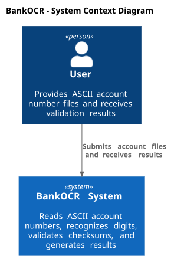

# 3. System Scope and Context

This chapter defines what BankOCR is responsible for and what lies outside its boundary. It describes the interactions between the system and its single external actor, the User.

---

## 3.1 Business Context

The User is a person who has one or more plain-text files containing ASCII representations of bank account numbers. The User submits a file to BankOCR and expects to receive a results file in which each account number is either confirmed as valid, flagged as erroneous (`ERR`), or marked as illegible (`ILL`).

BankOCR has no connection to any bank, payment network, or external data source. It performs purely local processing: it reads a file, applies digit recognition and checksum validation, and writes results.

| Actor | Interaction with BankOCR |
|-------|--------------------------|
| User | Provides an ASCII account number file as input; receives a plain-text results file as output |

---

## 3.2 System Context Diagram

The diagram below shows BankOCR as a black box and its relationship to the User.

> Source: [`architecture/diagrams/c4-context.puml`](./diagrams/c4-context.puml)

---

## 3.3 Technical Context

All communication between the User and BankOCR takes place through the local file system using plain-text files.

| Channel | Direction | Format | Description |
|---------|-----------|--------|-------------|
| Input file | User → BankOCR | Plain text | Each account entry occupies four lines: three rows of 27-character ASCII glyphs followed by one blank line (TC-2). |
| Output file | BankOCR → User | Plain text | One line per account number. Valid numbers appear unadorned; invalid numbers are suffixed with ` ERR`; illegible numbers are suffixed with ` ILL`. |

There are no network interfaces, message queues, databases, or external services involved (TC-3, TC-4, ADR-001).

---

## 3.4 System Boundary

The table below makes the inside/outside split explicit.

| Inside BankOCR's boundary | Outside BankOCR's boundary |
|---------------------------|----------------------------|
| Reading and parsing the input file | Creating or supplying the input file |
| Recognising ASCII glyphs as digits (0–9) | Defining or changing the glyph encoding |
| Assembling nine-digit account numbers | Any downstream use of validated account numbers |
| Validating account numbers with the mod-11 checksum | Banking or payment system integration |
| Writing the results file with `ERR` / `ILL` annotations | Displaying, storing, or forwarding results |
