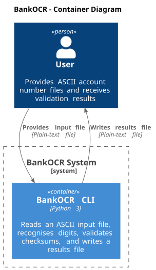
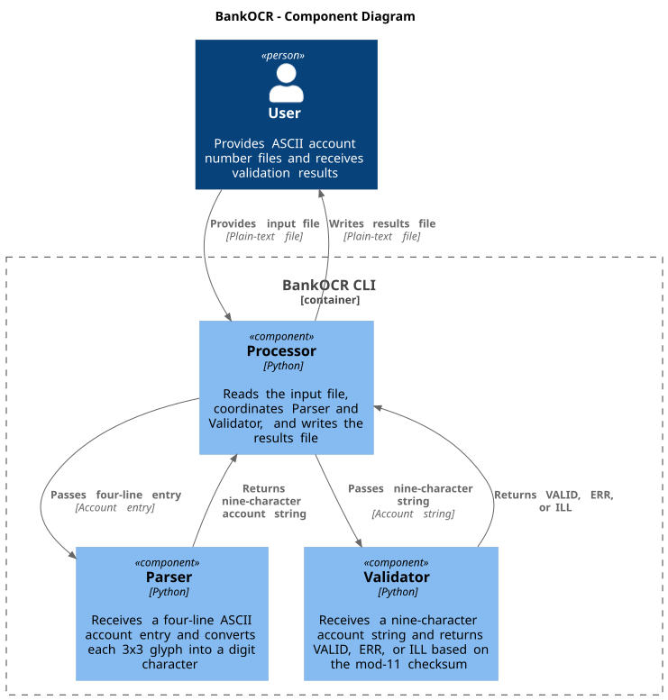

# 5. Building Block View

This chapter describes the internal structure of BankOCR at two levels: the system as a single deployable container, and the container's internal decomposition into three components.

---

## 5.1 Level 1 — Container View

BankOCR is a single deployable unit: a Python 3 CLI application. There are no additional containers, services, or databases. The User interacts with the application exclusively through plain-text files on the local file system.

> Source: [`architecture/diagrams/c4-container.puml`](./diagrams/c4-container.puml)

| Element | Type | Technology | Responsibility |
|---------|------|-----------|---------------|
| User | Person | — | Provides the ASCII input file; receives the results file |
| BankOCR CLI | Container | Python 3 | Reads the input file, processes all account entries, and writes the results file |

---

## 5.2 Level 2 — Component View

Inside the BankOCR CLI, responsibility is divided across three components. The Processor owns all file I/O and coordinates the other two. The Parser and Validator are independent of file I/O and of each other, which allows each to be tested in isolation.

> Source: [`architecture/diagrams/c4-component.puml`](./diagrams/c4-component.puml)

### Component responsibilities

| Component | Responsibility | Dependencies |
|-----------|---------------|-------------|
| **Processor** | Reads the input file and splits it into four-line account entries. Passes each entry to the Parser. Passes each parsed string to the Validator. Writes one annotated result line per account to the output file. | Parser, Validator, file system |
| **Parser** | Receives a four-line ASCII account entry. Maps each 3×3 glyph to its decimal digit (0–9). Returns a nine-character account string, using a placeholder character for any unrecognised glyph. | None |
| **Validator** | Receives a nine-character account string. Applies the mod-11 checksum (`d9 + 2·d8 + … + 9·d1 ≡ 0 mod 11`). Returns `VALID`, `ERR` (checksum failure), or `ILL` (unrecognised glyph present). | None |

### Dependency rules

- The Processor depends on the Parser and the Validator.
- The Parser has no dependency on the Validator, the Processor, or the file system.
- The Validator has no dependency on the Parser, the Processor, or the file system.

This structure keeps the two core logic components (Parser and Validator) independently testable with plain string inputs and no file fixtures.

---

## 5.3 Relationship to Approved Decisions

| Decision | Where reflected |
|----------|----------------|
| Single Python CLI application (ADR-001) | One container in the Level 1 view; no additional deployable units |
| Separation of concerns (ADR-001) | Three distinct components with non-overlapping responsibilities |
| No file I/O in Parser or Validator (Chapter 4) | File I/O is owned solely by the Processor |
| Plain-text files as the only I/O channel (TC-4) | The only interactions crossing the container boundary are file reads and writes |
