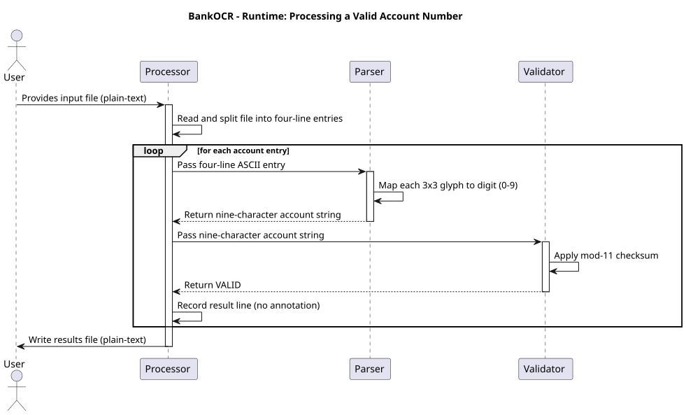
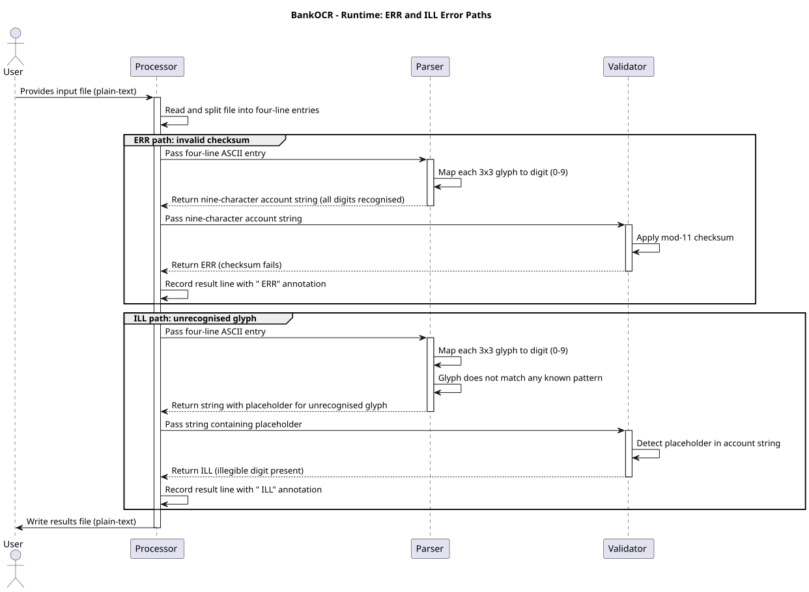

# 6. Runtime View

This chapter describes how the BankOCR components interact at runtime for the two important scenarios: processing a valid account number and handling the two error paths (`ERR` and `ILL`).

The static responsibilities of each component are defined in [Chapter 5](./05-building-block-view.md). The diagrams here show how those responsibilities play out in time.

---

## 6.1 Scenario 1 — Processing a Valid Account Number

This is the main success path. The User provides a file containing well-formed entries whose account numbers all pass the mod-11 checksum. The Processor drives the pipeline entry by entry; the Parser recognises every glyph; the Validator confirms each checksum; the results file contains bare account number lines with no annotations.

> Source: [`architecture/diagrams/seq-process-valid-account.puml`](./diagrams/seq-process-valid-account.puml)

### Step-by-step

| Step | Actor | Action |
|------|-------|--------|
| 1 | User | Provides the plain-text input file to the Processor |
| 2 | Processor | Reads the file and splits it into four-line account entries |
| 3 | Processor → Parser | Passes one four-line entry |
| 4 | Parser | Maps each 3×3 glyph to its decimal digit; returns a nine-character account string |
| 5 | Processor → Validator | Passes the nine-character string |
| 6 | Validator | Applies the mod-11 checksum; returns `VALID` |
| 7 | Processor | Records the account number without annotation |
| — | | Steps 3–7 repeat for every entry in the file |
| 8 | Processor → User | Writes the completed results file |

---

## 6.2 Scenario 2 — Error Paths: ERR and ILL

This scenario covers the two failure cases that can arise during processing. Both are handled within the same pipeline loop; the Processor writes an annotated result line in each case.

> Source: [`architecture/diagrams/seq-process-error-paths.puml`](./diagrams/seq-process-error-paths.puml)

### ERR path — checksum failure

All nine glyphs are recognised by the Parser, so it returns a clean nine-digit string. The Validator applies the mod-11 formula and finds the result is not divisible by 11. It returns `ERR`. The Processor appends ` ERR` to the result line.

### ILL path — unrecognised glyph

The Parser encounters a glyph that does not match any known 3×3 pattern. It returns the account string with a placeholder character in that position. The Validator detects the placeholder, skips the checksum calculation, and returns `ILL`. The Processor appends ` ILL` to the result line.

### Comparison of paths

| | ERR | ILL |
|-|-----|-----|
| Detected by | Validator | Validator (placeholder present) |
| Parser output | Nine recognised digits | String with placeholder(s) |
| Validator output | `ERR` | `ILL` |
| Result line annotation | ` ERR` | ` ILL` |

---

## 6.3 Runtime Invariants

These properties hold for every execution:

- The Processor is the only component that reads from or writes to the file system.
- The Parser is called exactly once per account entry and returns exactly one nine-character string.
- The Validator is called exactly once per parsed string and returns exactly one of `VALID`, `ERR`, or `ILL`.
- Every account entry in the input file produces exactly one line in the output file.
