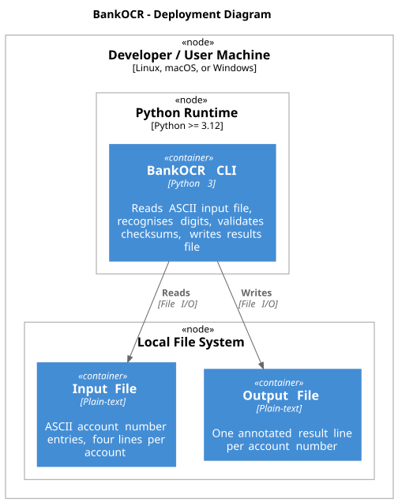

# 7. Deployment View

This chapter describes where and how BankOCR runs. Because the system is a single local CLI application with no network interfaces, services, or databases, the deployment topology is straightforward.

---

## 7.1 Deployment Topology

BankOCR runs entirely on a single machine. There is nothing to provision, configure, or operate beyond a Python 3 runtime and the presence of an input file on the local file system.

> Source: [`architecture/diagrams/deployment.puml`](./diagrams/deployment.puml)

| Element | Description |
|---------|-------------|
| **Developer / User Machine** | Any desktop or laptop running Linux, macOS, or Windows |
| **Python Runtime** | Python ≥ 3.12, installed locally; no virtual environment or package manager beyond the standard library is required at runtime |
| **BankOCR CLI** | The single Python application; invoked directly from the command line |
| **Input File** | Plain-text file on the local file system; provided by the User before invocation |
| **Output File** | Plain-text file written to the local file system by the application on completion |

---

## 7.2 Deployment Steps

No build, packaging, or installation pipeline is required. Deploying BankOCR means:

1. Ensure Python ≥ 3.12 is available on the target machine (TC-1).
2. Place the application source on the file system.
3. Invoke the CLI with the path to the input file.
4. Collect the output file from the path specified at invocation.

---

## 7.3 Deployment Constraints

| Constraint | Detail |
|-----------|--------|
| Python ≥ 3.12 required | The application uses only the standard library; no additional packages need to be installed (TC-1, TC-3) |
| Local execution only | No server, container image, or network connectivity is required or supported (ADR-001) |
| Plain-text file I/O | Input and output files must be accessible on the local file system (TC-4) |
| No external services | BankOCR does not call any external APIs, databases, or message queues (TC-3, TC-4) |

---

## 7.4 Development and Test Environment

During development, the same machine serves as both the development and runtime environment. The `unittest` framework runs tests directly against the source without any additional test infrastructure (TC-5). The pre-commit hook generates PlantUML SVGs from staged `.puml` files using a locally installed PlantUML JAR, which is the only tool dependency beyond Python itself.
